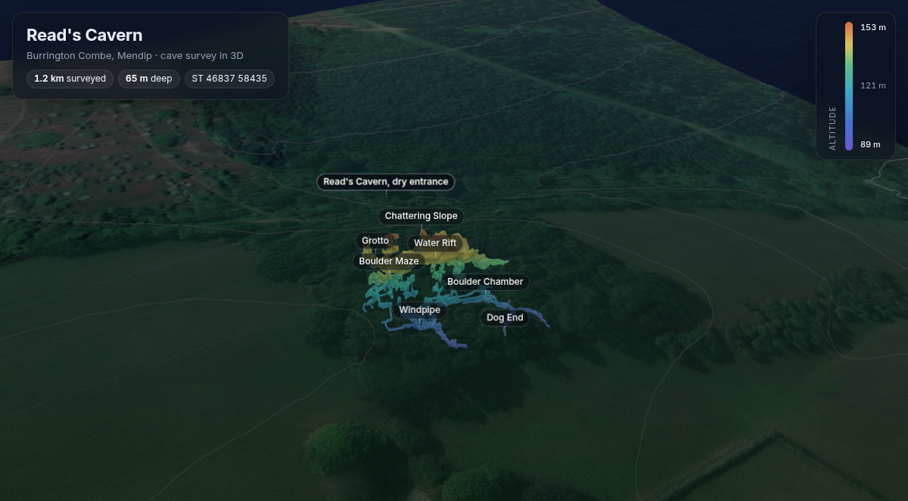
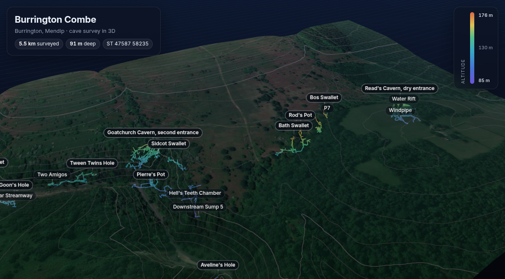
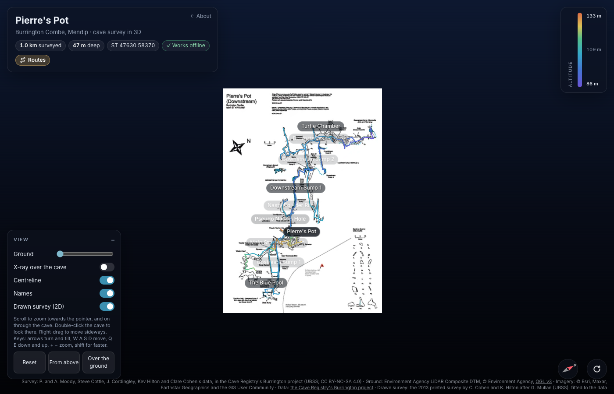

# Burrington Combe

[](https://cavesurveying.github.io/gb.mendips.burrington/)

## **[Open the site →](https://cavesurveying.github.io/gb.mendips.burrington/)**

The surveys of the caves of Burrington Combe, Mendip, Somerset: Goatchurch
Cavern, Read's Cavern, Pierre's Pot, Rod's Pot and Bath Swallet, Tween Twins,
Lionel's Hole, East Twin Swallet and Spar Pot, Drunkard's Hole, Sidcot
Swallet, Bos Swallet and Aveline's Hole, about **5.5 km** surveyed in all.
The site shows them in 3D under the ground surface, gives each cave a page of
its own, and draws the plans over them where there are plans. It's rebuilt
from this repository every time it changes.

| On the site | |
|---|---|
| [The whole combe in 3D](https://cavesurveying.github.io/gb.mendips.burrington/3d/) | Every cave together under the Environment Agency's LiDAR and aerial imagery, with every entrance and passage named. |
| [Goatchurch Cavern](https://cavesurveying.github.io/gb.mendips.burrington/goatchurch/) | 1.4 km: the 2006 survey with walls from its passage measurements, and the 2012 resurvey's plan of the entrance series. |
| [Read's Cavern](https://cavesurveying.github.io/gb.mendips.burrington/reads/) | 1.2 km: drawn in Therion, with its plan to print and walls from the drawings. |
| [Pierre's Pot](https://cavesurveying.github.io/gb.mendips.burrington/pierres/) | 1.0 km, with the 2013 printed survey fitted under it. |
| [Rod's Pot and Bath Swallet](https://cavesurveying.github.io/gb.mendips.burrington/rodsbath/) | 0.6 km, with walls. |
| [Tween Twins Hole](https://cavesurveying.github.io/gb.mendips.burrington/tween/) | Drawn in Therion. |
| [Lionel's Hole](https://cavesurveying.github.io/gb.mendips.burrington/lionels/) | Only 0.3 km of its maze is surveyed here. |
| [Drunkard's Hole](https://cavesurveying.github.io/gb.mendips.burrington/drunkards/), [Bos Swallet](https://cavesurveying.github.io/gb.mendips.burrington/bos/) | With their printed surveys fitted under them. |

[](https://cavesurveying.github.io/gb.mendips.burrington/3d/)

Pages with a drawn plan show it over the cave: Pierre's Pot here, from the UBSS's 2013 printed survey, fitted to the data.

[](https://cavesurveying.github.io/gb.mendips.burrington/pierres/3d/#plan=1)

## Where the data comes from

This is a copy of the Cave Registry Data Archive's **Burrington** Therion and
Survex project, with its history: every Subversion revision is a commit here,
with its author, date and message, and `SVN-Revision` and `SVN-URL` at the end
of the message. **The source of truth is the SVN repository,
<http://cave-registry.org.uk/svn/Burrington/>:** that's where the surveys are
worked on and where changes go, so don't make survey changes here. The surveys
are the University of Bristol Spelaeological Society's
[Burrington Area Survey](https://ubss.org.uk/research/cave_surveys/burrington/),
released under Creative Commons BY-NC-SA; their credits are as their own files
give them.

Until the switch to git, a scheduled workflow
([`.github/workflows/svn-sync.yml`](.github/workflows/svn-sync.yml)) brings in
each new revision every day, with [`tools/svn_sync.py`](tools/svn_sync.py)
(it needs Subversion's `svn` client, but no checkout):

```bash
python3 tools/svn_sync.py
```

## The site

Built by [cave-viewer](https://github.com/CaveSurveying/cave-viewer) on every
push ([`.github/workflows/build.yml`](.github/workflows/build.yml)) and
published to GitHub Pages from `main`. What it's built from, besides the
surveys, is in [`web/`](web/): cave-viewer's config (`caves.json`), the notes
on each page (`notes/`), the UBSS's printed surveys of Drunkard's Hole, Pierre's
Pot and Bos Swallet with their fits (`drawn/`), and the LiDAR. To build it:

```bash
tools/build_inputs.sh                                          # survex, therion, poppler
(cd web && python -m caveviewer build caves.json --out ../site --no-fetch)
python3 -m http.server -d site                                 # then open http://localhost:8000
```

`tools/build_inputs.sh` compiles the whole project as its own `thconfig`
does, then gives each Survex cave its part of that (`tools/split3d.py`), walls
where there are measurements for them, and Goatchurch's 2012 resurvey as a plan
tied to the 2006 survey (`tools/goatchurch2012.sh`). Read's, Tween Twins and Bos
are Therion projects, which cave-viewer builds itself.

| | |
|---|---|
| `docs/` | The pictures in this README. |
